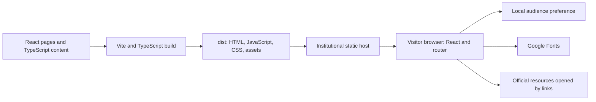

# Application infrastructure

Reviewed against the repository source on October 20, 2026. This document describes the current public beta and its deployment requirements. Production host details are owned by the receiving webmaster/development team and are not yet recorded here.

## Overview

Bellini Degree Explorer is a client-rendered React single-page application. Visitors choose one of four audiences, explore degree information, open official resources, and compare two programs. Degree content is compiled into the application; pages do not retrieve it from a database or API at runtime.

The production artifact is a directory of static HTML, JavaScript, CSS, and assets. A static web host serves those files, and JavaScript renders the interface in the browser. Node.js is required to install dependencies, build, and run development checks; the deployed application does not require a Node.js application server.



## Stack and configuration

| Component | Role | Configuration/source |
| --- | --- | --- |
| React 19 / React DOM | Client-side components and rendering | [package.json](../package.json), [main.tsx](../src/main.tsx) |
| TypeScript 6 | Static type checks before bundling | [tsconfig.app.json](../tsconfig.app.json), [tsconfig.node.json](../tsconfig.node.json) |
| Vite 8 with React plugin | Development server and production bundling | [vite.config.ts](../vite.config.ts) |
| React Router 7 | Browser history routing and query parameters | [App.tsx](../src/App.tsx), [main.tsx](../src/main.tsx) |
| Lucide React | Bundled interface icons | [package.json](../package.json) |
| CSS | Global, dashboard, degree, and responsive styling | `src/index.css`, `src/styles/` |
| ESLint / Node test runner | Linting and regression checks | [eslint.config.js](../eslint.config.js), `tests/` |

Use Node 22.12 or later in the Node 22 line for the documented setup; [.nvmrc](../.nvmrc) selects Node 22. The package engine declaration also allows Node 24 and 25. Exact installed package versions are recorded in [package-lock.json](../package-lock.json); use `npm ci` to install from that lockfile. Recorded verification environments and dates are in [beta-verification.md](beta-verification.md).

## Startup and page rendering

1. The host serves [index.html](../index.html), containing the `root` mounting element, favicon, metadata, and font stylesheet.
2. [main.tsx](../src/main.tsx) mounts React with `StrictMode`, `BrowserRouter`, and an application error boundary.
3. [App.tsx](../src/App.tsx) selects the page from the browser URL. Page modules load through `React.lazy`; `Suspense` displays a loading state while those modules arrive.
4. The selected page reads bundled data and renders its interface. Filtering and comparison selection run locally in React state.

The shared app header is hidden on dashboard routes; dashboards supply their own layout. [RouteAccessibility.tsx](../src/components/RouteAccessibility.tsx) assigns the main-content target, updates the browser title, and manages focus/scroll after route changes. [AppErrorBoundary.tsx](../src/components/AppErrorBoundary.tsx) provides a reload/return screen for rendering failures. Unmatched routes render the missing-page screen.

## Routes and audience context

Routes are declared in `src/App.tsx`. All listed application routes are public.

| Route | Purpose |
| --- | --- |
| `/`, `/select-user-type` | Audience selection |
| `/dashboard/prospective-student` | High-school/prospective dashboard |
| `/dashboard/transfer-student` | Non-USF/transfer dashboard |
| `/dashboard/current-usf-student` | Current USF student outside Bellini dashboard |
| `/dashboard/current-bellini-student` | Current Bellini student dashboard |
| `/degrees` | Shared degree explorer |
| `/degrees/:degreeSlug` | Shared degree detail |
| `/degrees/compare` | Shared two-program comparison |
| `/degrees/bachelors-masters-pathways`, `/career-paths` | Shared supporting resources |
| `/degrees/future-options` | Separate anticipated-program page |
| `/high-school/degrees` | Plain-language degree explorer |
| `/high-school/degrees/:degreeSlug` | Plain-language degree detail |
| `/high-school/degrees/compare` | Plain-language comparison |
| `/high-school/degrees/bachelors-masters-pathways`, `/high-school/career-paths`, `/high-school/parent-info` | Prospective-student supporting resources |
| `/high-school/degrees/future-options` | Plain-language anticipated-program page |

Legacy `/home`, `/login`, and `/signup` routes redirect to `/`. `/dashboard/general` redirects to `/degrees`.

Shared degree pages use a `from` query parameter to retain dashboard context. [degreeSource.ts](../src/utils/degreeSource.ts) accepts `current-usf-student`, `current-bellini-student`, `transfer-student`, and legacy `general`; missing or unrecognized values default to Bellini context. High-school pages have their own route family and audience wording.

Comparisons identify programs through `first` and `second` query parameters, for example:

```text
/degrees/compare?first=computer-science&second=artificial-intelligence&from=current-bellini-student
```

Programs are looked up by slug. Pages provide recovery for invalid, missing, or duplicate selections. Two distinct programs are required to compare; explorer selection is limited to two. [degreeComparison.ts](../src/utils/degreeComparison.ts) contains the shared explorer selection/path helpers; the high-school explorer implements its selection handling in its own page.

## Content and state flow

There is no runtime CMS or server-side content store. Content changes require editing source, rebuilding, and redeploying.

| Source | Responsibility |
| --- | --- |
| `src/data/degrees.ts` | Shared main-degree cards, summaries, comparison fields, and resource data |
| `src/data/highSchoolDegrees.ts` | Plain-language main-degree dataset |
| `src/data/highSchoolFutureDegreeOptions.ts` | Canonical interdisciplinary slugs, names, summaries, catalog/planning resources, and anticipated options |
| `src/data/interdisciplinaryDetailContent.ts` | Shared interdisciplinary detail content |
| `src/data/highSchoolInterdisciplinaryContent.ts` | Plain-language interdisciplinary cards, details, and comparison content |
| `src/pages/degrees/DegreeDetail.tsx`, `src/pages/highSchool/degrees/HighSchoolDegreeDetail.tsx` | Main-degree detail sections, including embedded coursework/career/resource information |
| `src/components/InterdisciplinaryDegreeDetail.tsx`, `src/components/AnticipatedDegreeOptions.tsx` | Shared rendering for interdisciplinary details and anticipated options |

Both explorer datasets incorporate the canonical interdisciplinary records. The explorers contain five main programs and seven interdisciplinary programs/concentrations. Economics and Anthropology are separate anticipated options, excluded from selectable comparisons. Display does not establish admissions availability or academic approval. See [content-review.md](content-review.md) for sources and review requirements.

| State | Location | Lifetime |
| --- | --- | --- |
| Selected audience | Browser `localStorage`, key `cicUserType` | Persists on that browser/origin until cleared |
| Explorer filter and comparison selection | Component state (`useState`) | Resets when the component is remounted or the page reloads |
| Comparison pair and shared audience context | URL query parameters | Preserved in copied URLs/history |
| Degree content | Bundled TypeScript modules | Updated through a new build/deployment |

[userSession.ts](../src/utils/userSession.ts) validates stored audience values and catches browser-storage failures. The stored value is an audience preference, not a login, identity, or permission. Storage is not synchronized across devices. No accounts, transcript storage, saved student plans, or server sessions are implemented.

## External dependencies and data boundaries

- **Fonts:** `index.html` requests Amarna, Anton, and Saira through `fonts.googleapis.com`; font files are served from `fonts.gstatic.com`. These are browser requests to external origins. The hosting team must account for them in site policy or provide approved replacements.
- **Academic resources:** ordinary links open official USF pages, catalogs, Box study plans, Canvas resources, and other referenced pages. These resources are not imported into a database by the app; some destinations may require authentication or show access challenges.
- **Advising email:** `mailto:` links hand off to the visitor’s email application. The app has no email-delivery service.
- **Development link checks:** `npm run check:links` checks source URL syntax locally. The optional `--online` flag sends requests to the URLs found in source and writes `docs/external-link-report.json`. This is a development script, not a browser runtime API.

The current application has no backend API client, database connection, application analytics integration, upload endpoint, or authentication provider. No environment variables or service credentials are needed to build or run this beta. Institutional hosting may have its own access logs and monitoring; that infrastructure is outside the source application described here.

## Build and development workflow

Run commands from the repository root:

```bash
npm ci
npm run dev
```

The development server prints its local URL. For a production build and local inspection:

```bash
npm run build
npm run preview
```

`build` runs TypeScript project checks followed by Vite bundling. Vite writes the entry HTML, bundled CSS/JavaScript, and copied public assets to `dist/`. Lazy page imports create additional JavaScript chunks. The optimized logo is imported from `src/assets/`; `public/favicon.svg` is a public asset. Deploy the complete build together, including its chunks.

`npm run check` runs lint, Node/server-rendering regression tests, source URL syntax checks, and a production build. It does not run browser end-to-end, screen-reader, or deployed-host checks. `npm run dev` and `npm run preview` are local tools, not production servers. Build dependencies and generated output are ignored by Git.

## Deployment boundary and hosting assumptions

The receiving webmaster/development team owns hosting, staging, website integration, deployment configuration, and release/rollback procedures. This section communicates application requirements rather than choosing their platform.

- The current Vite configuration has no custom `base`, and `BrowserRouter` has no `basename`; the app currently assumes the website root. A subfolder deployment requires reviewing the asset base, router base, and explicit root-relative URLs such as the favicon.
- BrowserRouter uses normal URL paths. Direct requests and refreshes on app routes need the host to serve the app entry HTML, with any fallback limited to the app’s section and without swallowing asset requests or unrelated website pages. If the platform cannot support this, routing needs an agreed adaptation.
- HTTPS, content security policy, caching, approved font origins, and embedding restrictions are host responsibilities. If the team selects iframe or direct CMS integration, layout, focus, framing, and style compatibility require verification in that environment.
- Serve assets with suitable content types and ensure the new entry HTML and its referenced versioned chunks remain consistent during releases. The final URL and host-specific process should be recorded by the deployment team when known.

No host, staging URL, production URL, deployment automation, or live monitoring configuration is defined by this repository. Their absence does not require a backend for the current features.

## Scope of future infrastructure

“Coming soon” cards are intentionally visible and disabled. Implementing accounts, student transcript uploads, saved plans, or recommendations that retain student information would introduce new infrastructure and institutional-review requirements. No student-data storage architecture is selected or approved by the current beta. Keep that future work separate from this static deployment.

For current test evidence and outstanding review limitations, see [beta-verification.md](beta-verification.md). For content ownership, sources, and update locations, see [content-review.md](content-review.md).
